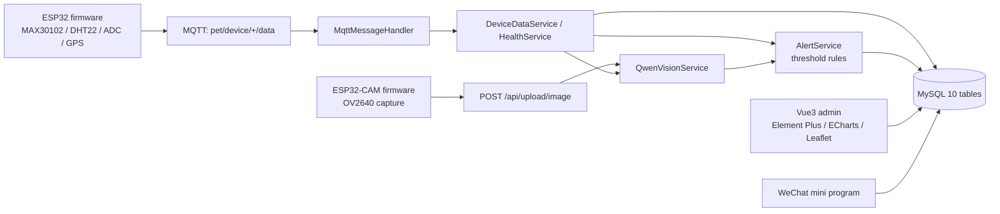

# Pet Health Agent

**English** | [简体中文](README.md)


> A full-stack pet health monitoring system, from firmware to agent:
> ESP32 sensors (heart rate / temperature / activity / GPS) → MQTT → Spring Boot backend →
> threshold-based alerts → Qwen-Max explanations → Vue 3 admin console + WeChat mini program.
>
> Firmware, backend, frontend, mini program and KiCad schematics are all in this repository.

## The design decision that matters

Most "smart pet" products either show raw numbers (a heart rate of 178 means nothing without
breed/weight context) or hand the whole judgement to an LLM, which happily invents a diagnosis.

This project splits the two responsibilities:

| Layer | Owner | Why |
| --- | --- | --- |
| **Is it abnormal, and how severe** | deterministic threshold rules (species / weight class / duration) | safety-relevant decisions must be reproducible and testable |
| **Why is it abnormal, what to do** | Qwen-Max, with the pet's profile injected into the system prompt | this is what language models are good at, and a wrong suggestion is recoverable |

**Alerts never depend on model output. The model only translates an alert into plain language.**

## Architecture



## Layout

```
backend/    Spring Boot 3.1.5, Java 17 — 83 classes, ~6000 lines
            ai/ (QwenLLMService, QwenVisionService, PromptBuilder)
            mqtt/ (config, connector, handler, publisher, simulator)
            security/ controller/ service/ entity/ mapper/
frontend/   Vue 3 + Vite + TS + Element Plus + Pinia (admin console)
miniapp/    native WeChat mini program (owner-facing, 65 files)
hardware/   ESP32 firmware (PlatformIO), ESP32-CAM firmware, KiCad schematic, wiring docs
```

## Quick start

```bash
# 1. database
mysql -uroot -p -e "CREATE DATABASE pet_health DEFAULT CHARSET utf8mb4;"
mysql -uroot -p pet_health < backend/src/main/resources/db/schema.sql

# 2. backend  (fill DB_PASSWORD and QWEN_API_KEY in .env first)
cp .env.example .env
cd backend && mvn spring-boot:run

# 3. admin console
cd frontend && npm install && npm run dev

# 4. firmware (edit include/config.h first)
cd hardware/firmware && pio run -t upload
```

Swagger UI at `http://localhost:8080/api/swagger-ui.html`.

**No hardware required to see it work**: `mqtt/HeartRateSimulator` publishes synthetic readings
through the same MQTT pipeline, so backend + frontend alone reproduce the full alert flow.

## Notable details

- MQTT topic prefixes are duplicated in the backend parser and the firmware — `config.h` carries an
  explicit warning comment because this has bitten before.
- Health **score** (0-100, for humans) and **alert level** (4 tiers, for the system) are separate
  models, so intermediate states ("score dropped, not yet alerting") can be expressed.
- No plaintext credentials anywhere: `application.yml` reads everything from environment variables,
  the firmware only ships `config.h` placeholders.

## Known limitations

- **No backend tests yet** — 83 classes and an empty `src/test` is the biggest gap. Threshold and
  scoring logic is verified by hand only. JUnit + Testcontainers is the top priority.
- **No CI**: Maven dependency set is heavy and the local machine has no build environment, so no
  badge rather than a possibly-red one.
- `HeartRateSimulator` produces simulated data; a real MAX30102 on a demo board is far noisier.
- The `knowledge_base` table exists but is not wired to retrieval — Q&A is pure prompting, no RAG.
- Admin console and mini program share one JWT; there is no fine-grained role separation yet.

## Roadmap

- [ ] Tests for alert thresholds, health scoring, MQTT parsing
- [ ] GitHub Actions (`mvn -B test`, `npm run build`)
- [ ] Vector retrieval over `knowledge_base` (RAG)
- [ ] SSE streaming for chat
- [ ] Role-based access for admin vs. owner
- [ ] Per-pet threshold overrides

## License

[MIT](LICENSE) © 2026 DOUFUQAQ
