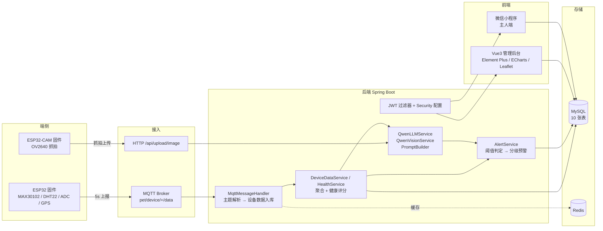

# Pet Health Agent · 宠物健康管家

[English](README.en.md) | **简体中文**


> 一套从**硬件到智能体**的宠物健康监测系统：ESP32 采集心率 / 体温 / 活动量 / 位置 →
> MQTT 上报 → Spring Boot 后端判定健康状态 → 通义千问生成解释与护理建议 →
> Vue3 管理后台 + 微信小程序双端呈现。
>
> 仓库包含固件、后端、后台、小程序和硬件原理图，是一个完整闭环而不是接口 demo。

---

## 这个项目真正想解决的问题

「智能宠物设备」的常见做法是把传感器数据画成曲线，超标了弹个红点。它有两个毛病：

1. **只有数据没有解释**。主人看到"心率 178"并不知道这算不算严重——不同品种、体重、年龄的正常区间完全不同。
2. **有解释的地方又不敢信**。把所有判断都交给大模型，模型会一本正经地编造"您的猫可能有心肌炎"。

本项目的取舍是**把判断和建议拆成两层**：

| 层 | 谁来做 | 为什么 |
| --- | --- | --- |
| **是否异常、几级预警** | 后端**确定性阈值规则**（品种 / 体重档位 / 持续时长） | 安全相关的判定必须可复现、可回归测试，不能随机 |
| **为什么会异常、该怎么护理** | **Qwen-Max** 生成，prompt 里注入该宠物的档案（品种、体重、病史、过敏史） | 这是语言模型的强项，而且错了代价可控（只是建议） |

换句话说：**告警绝不依赖模型输出，模型只负责把告警翻译成人话。** 这条边界是这个项目里最重要的设计决定。

---

## 架构



---

## 仓库结构

```
pet-health-agent/
├── backend/                    Spring Boot 3.1.5 / Java 17（83 个类，约 6000 行）
│   ├── pom.xml
│   └── src/main/
│       ├── java/com/pethealth/
│       │   ├── ai/             QwenLLMService · QwenVisionService · PromptBuilder
│       │   ├── mqtt/           MqttConfig · Connector · MessageHandler · Publisher
│       │   ├── security/       JWT 过滤器与认证配置
│       │   ├── controller/     10 个 REST 控制器（Auth/Pet/Device/Health/Alert/Chat/…）
│       │   ├── service/        8 个服务接口 + 实现
│       │   ├── entity/ mapper/ MyBatis-Plus 实体与 Mapper
│       │   └── dto/ vo/ common/ utils/ exception/
│       └── resources/
│           ├── application.yml 全部凭据走环境变量
│           ├── mapper/*.xml
│           └── db/schema.sql   10 张表的建表语句
├── frontend/                   Vue3 + Vite + TS + Element Plus + Pinia（管理后台）
├── miniapp/                    原生微信小程序（主人端，65 个文件）
├── hardware/
│   ├── firmware/               ESP32 主控（PlatformIO）
│   ├── firmware-cam/           ESP32-CAM 抓拍上传
│   ├── firmware-cam-web/       ESP32-CAM HTTP 取帧（小程序直连）
│   ├── kicad/                  KiCad 原理图源文件
│   └── docs/                   引脚连接表 / 电源设计 / 网表 / 接线步骤
├── .env.example
└── LICENSE
```

---

## 核心模块

| 模块 | 位置 | 职责 |
| --- | --- | --- |
| 设备接入 | `mqtt/MqttMessageHandler` | 解析 `pet/device/{code}/data`，把 JSON 落库为 `device_data`，异常设备心跳标记离线 |
| 健康评分 | `service/impl/HealthServiceImpl` | 聚合当日体温极值、心率区间、活动量，按规则扣分得到 0-100 健康分 |
| 预警判定 | `service/impl/AlertServiceImpl` | 体温偏离 `±1℃` 判 CRITICAL，区间外判 WARNING；心率/活动量按 `alert.rules` 的持续时长触发 |
| 智能问答 | `service/impl/ChatServiceImpl` | 把宠物档案拼进 system prompt，支持多轮；会话存 `chat_history` |
| 多模态分析 | `ai/QwenVisionService` | 调 Qwen-VL 分析抓拍图像/视频，判断行为是否异常 |
| 认证 | `security/` + `AuthController` | JWT（HS512）+ 拦截器，管理端与小程序共用同一套令牌 |
| 后台 | `frontend/src/views/` | 仪表盘、宠物、设备、预警、用户五个管理视图；Leaflet 显示设备位置 |

**Prompt 的构造**（`PromptBuilder`）不是简单拼一句"你是宠物医生"，而是把结构化档案注入 system prompt：

```java
sb.append("- 名字：").append(pet.getName()).append("\n");
sb.append("- 物种：").append(pet.getSpecies()).append("\n");
if (pet.getWeight() != null) sb.append("- 体重：").append(pet.getWeight()).append("kg\n");
if (pet.getAllergies() != null) sb.append("- 过敏史：").append(pet.getAllergies()).append("\n");
```

同一个宠物每次对话都带着这段上下文，模型给的建议才不会"对狗说猫话"。

---

## 快速开始

### 1. 数据库

```bash
mysql -uroot -p -e "CREATE DATABASE pet_health DEFAULT CHARSET utf8mb4;"
mysql -uroot -p pet_health < backend/src/main/resources/db/schema.sql
```

### 2. 后端

```bash
cd backend
cp ../.env.example ../.env       # 填 DB_PASSWORD、QWEN_API_KEY
# .env 通过环境变量注入，也可以直接 export
mvn spring-boot:run
```

启动后：

- 接口文档 <http://localhost:8080/api/swagger-ui.html>
- Druid 监控台 <http://localhost:8080/api/druid/>（账号由 `DRUID_USERNAME/PASSWORD` 决定）

### 3. 管理后台

```bash
cd frontend
npm install
npm run dev        # 默认 http://localhost:5173，代理到 8080
```

### 4. 小程序

用微信开发者工具打开 `miniapp/`，把 `utils/api.js` 里的 `BASE_URL` 改成后端地址。
`project.private.config.json`（含个人 appid）已在 `.gitignore` 中，请自行创建。

### 5. 固件

```bash
cd hardware/firmware
# 先改 include/config.h 里的 WIFI_SSID / WIFI_PASSWORD / MQTT_HOST
pio run -t upload
```

`config.h` 在仓库里只有占位符；真实凭据请本地填写，**不要提交**。

**没有真实硬件也能跑通后端**：`mqtt/HeartRateSimulator` 会生成模拟心率数据走同一条 MQTT 链路，
所以只起后端 + 前端就能看到完整的曲线和预警流程。

---

## 设计细节值得一说的地方

- **MQTT 主题前缀写死在后端解析器和固件里两处**，改一个必须改另一个——
  所以 `hardware/firmware/include/config.h` 顶部特意写了注释提醒，这是踩过的坑。
- **上传接口按文件类型分流**：图片走 Qwen-VL，视频抽帧后同样走 Qwen-VL，
  超时时间在 `ai.timeout` 里单独配置，避免慢请求把 Tomcat 线程占满。
- **健康评分与预警是两套东西**：分数给人看的（0-100），预警给系统看的（4 级）。
  分开之后，"分数掉了但没到预警线"这种中间状态才有地方表达。
- **凭据一律走环境变量**：`application.yml` 里没有任何明文密钥，固件的 `config.h` 只提交占位符。

## 已知局限

- **后端没有自动化测试**。这是目前最大的短板：83 个类、6000 行，`src/test` 是空的，
  预警阈值这类核心逻辑完全靠人工验证。补齐 JUnit + Testcontainers 是下一步的第一优先级。
- **CI 未接入**。Maven 依赖较重，本地没有构建环境，暂不敢放一个可能变红的徽章上去。
- **`HeartRateSimulator` 提供的是模拟数据**，MAX30102 在演示板上的接触稳定性不够，
  真实设备的读数噪声比模拟器大得多。
- **知识库表 `knowledge_base` 有建表但还没接检索**，问答目前是纯 prompt，没有 RAG。
- **小程序与后台共用一套 JWT**，但没有做细粒度权限，普通用户理论上能调到管理端接口。

## Roadmap

- [ ] 补 `src/test`：预警阈值规则、健康评分、MQTT 报文解析的单测 + 集成测试
- [ ] 接入 GitHub Actions（`mvn -B test` + 前端 `npm run build`）
- [ ] `knowledge_base` 接入向量检索，把问答升级成 RAG
- [ ] 会话改成 SSE 流式返回
- [ ] 管理端 / 小程序拆权限，引入角色表
- [ ] 温度、心率阈值支持按宠物个体覆盖（现在是全局配置）

## License

[MIT](LICENSE) © 2026 DOUFUQAQ
